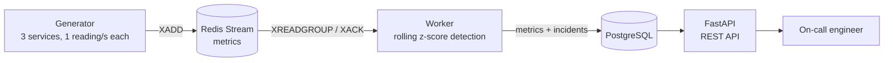

# PulseWatch

**A real-time anomaly detection and alerting pipeline.** PulseWatch watches the response times of (simulated) web services, spots unusual spikes as they happen, opens incidents for them, and lets an on-call engineer acknowledge and resolve them through a REST API.

It runs 24/7 on AWS EC2 as five Docker containers, with no data loss when parts of it crash.

**Live API:** http://18.170.212.132:8000/docs (interactive API docs; the demo server may occasionally be offline)

---

## Results

Measured on the live EC2 deployment over 12 hours of continuous operation:

| Metric | Result |
|---|---|
| Readings processed | **131,403** (about 3 per second) |
| Injected latency spikes | **2,591** |
| Spikes detected | **96.8%** (2,509) |
| False-positive rate | **0.39%** (496 of 128,812 normal readings) |
| Automatic recovery after a server reboot | Yes |
| Messages lost across crashes and outages | **0** (verified by failure-injection tests) |

**How these are measured:** every injected spike carries an error rate of exactly 0.3, while normal readings sit around 0.01. That gives ground truth, so detection rate and false positives are counted exactly with SQL against the production database, not estimated.

**What the measurement led to:** almost half the false alarms (244 of 496) were readings that were unusually *fast*, which nobody would ever page an engineer for. The detector was changed to alert only on high-side deviations. Re-measurement with the new rule is in progress.

---

## Architecture



1. **Generator** simulates three services (`checkout`, `auth`, `search`). Each reports a latency reading every second, around 120 ms. 2% of readings are injected spikes at five times normal latency.
2. **Redis Streams** sits between producing and processing, so either side can stop, restart or scale without the other noticing.
3. **Worker** reads the stream as part of a consumer group, stores every reading in PostgreSQL, and checks it against that service's last 30 readings. If a reading is more than 3 standard deviations above the recent mean, it opens an incident.
4. **FastAPI** exposes metrics and incidents, and lets an engineer move an incident from **open** to **acknowledged** to **resolved**.

---

## Reliability

These were each tested by deliberately breaking the system.

| Failure | What happens | How it was tested |
|---|---|---|
| Worker crashes | Redis consumer groups track what was acknowledged. On restart the worker first re-processes its own unfinished messages, then carries on. Nothing is skipped. | Killed the worker while the generator kept running; also left messages pending by hand with `XREADGROUP` and watched the worker recover them (`XPENDING` 3 → 0). |
| Database goes down | The worker catches the connection error and reconnects with exponential backoff (1s, 2s, 4s… capped at 30s). The message being processed is not acknowledged, so it is retried. | `docker compose stop postgres`, then `start`, while the pipeline was running. |
| Malformed message | Logged, acknowledged and skipped, so one bad event cannot jam the stream on every restart (a "poison message"). | Injected `latency_ms=abc` into the stream. |
| Server reboot | Docker starts on boot and every container has `restart: unless-stopped`. | `sudo reboot` on the EC2 instance. |

Delivery is **at-least-once**: if the worker crashes after saving a reading but before acknowledging it, that reading can be saved twice. That is the standard trade-off for never losing data.

---

## Design decisions

- **Rolling z-score instead of a fixed threshold.** A fixed "alert above 300 ms" breaks as soon as a service's normal speed changes. Comparing each reading with that service's own recent behaviour adapts automatically.
- **20-reading warm-up.** With very little history the standard deviation is unreliable and causes false alarms, so the detector stays quiet until it has 20 readings.
- **One-sided threshold.** Changed after measuring production data (see Results): being unusually fast is not an incident.
- **Redis Streams with consumer groups.** Cheaper and simpler to run than Kafka at this scale, while still giving acknowledgements, replay and room to add more workers.
- **Thin loops, testable logic.** The infinite loops in the worker and generator only connect and read. All decisions live in small functions (`parse_message`, `update_history`, `process_message`, `next_delay`) that are unit-tested.
- **Schema managed by Alembic migrations**, so the database can be rebuilt or upgraded in any environment with one command.
- **Configuration from environment variables**, so the same code runs on a laptop, in CI and on EC2. Secrets live in a `.env` file that is never committed (see `.env.example`).

---

## API

| Method | Endpoint | Description |
|---|---|---|
| GET | `/health` | Liveness check |
| GET | `/metrics?limit=50` | Latest readings (`limit` 1–500, otherwise 422) |
| GET | `/incidents` | All incidents, newest first |
| GET | `/incidents/{id}` | One incident (404 if missing) |
| POST | `/incidents/{id}/acknowledge` | Open → acknowledged (409 if not open) |
| POST | `/incidents/{id}/resolve` | → resolved (409 if already resolved) |

---

## Running it locally

Requires Docker.

```bash
git clone https://github.com/BismarkA17/pulse-watch.git
cd pulse-watch
cp .env.example .env          # then set your own POSTGRES_PASSWORD
docker compose up -d --build
```

Then open http://localhost:8000/docs. Follow the worker with `docker compose logs -f worker`.

### Running the tests

```bash
python -m venv .venv && source .venv/bin/activate
pip install -r requirements.txt
docker compose up -d postgres
docker compose exec postgres createdb -U pulsewatch pulsewatch_test   # first time only
python -m pytest --cov=pulsewatch --cov-report=term-missing
```

26 tests cover detection, the API and the worker logic, including integration tests against a separate test database that is migrated automatically and cleaned before every test. GitHub Actions runs the suite on every push and fails the build if coverage drops below 80%. The connection loops (`run_worker`, `main`) are excluded from unit coverage and verified by the failure tests above.

---

## Deployment

Runs on a single AWS EC2 instance (t3.small, Ubuntu, London region):

- Docker Engine starts on boot; Compose brings up Postgres and Redis (with healthchecks), runs migrations, then starts the API, worker and generator.
- The security group allows the API port publicly and SSH only from a known address range. PostgreSQL and Redis are not reachable from the internet.
- Deploying a change is `git pull && docker compose up -d --build`.

---

## Project structure

```
pulsewatch/
  generator.py     simulated services writing to the Redis stream
  worker.py        consumer group, detection, reconnect logic
  detection.py     rolling z-score
  api.py           FastAPI endpoints
  config.py        settings from environment variables
migrations/        Alembic schema migrations
tests/             pytest suite (unit + integration)
.github/workflows/ CI pipeline
Dockerfile, docker-compose.yml
```

---

## What's next

- Grafana dashboard for live metrics
- An incident-management page with severity levels, resolution notes, and time-to-acknowledge / time-to-resolve tracking
- Simulated multi-minute outages, so incidents behave more like real ones
- Retention policy for old readings
